# Bharat CultureMap — Full-Stack Technical Architecture & Web Feature Dossier

> [!NOTE]
> **Project Identity & Pilot Context**: **Bharat CultureMap** (`v1.2.1`) is a practitioner-governed living heritage documentation, discovery, and ethical marketplace platform designed specifically for the **Kolhapur Pilot Study** (*"Voice, Consent, and Credit"*). It implements sovereign cultural intellectual property protection for indigenous artisans, folklore traditions, and community knowledge keepers.

---

## 1. Executive Summary & Web Platform Architecture

Bharat CultureMap is architectured as a unified, single-port full-stack TypeScript web application. It combines a modern **React 19** Single-Page Application (SPA) frontend with an embedded **Express 4.21** REST API engine backed by a normalized **SQLite 3 (WAL mode)** database.

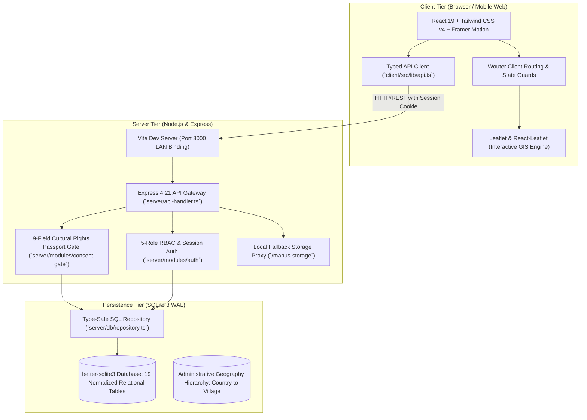

### Full-Stack Technology Stack

| Layer | Technologies & Libraries | Key Responsibilities |
| :--- | :--- | :--- |
| **Frontend Framework** | [React 19.2.1](file:///D:/Bharat%20Culture%20Map%201/package.json#L61), [Vite 7.1.7](file:///D:/Bharat%20Culture%20Map%201/package.json#L98), [TypeScript 5.6.3](file:///D:/Bharat%20Culture%20Map%201/package.json#L97) | Modern component architecture, concurrent rendering, and zero-bundle hydration. |
| **Styling & Animation** | [Tailwind CSS v4](file:///D:/Bharat%20Culture%20Map%201/package.json#L94), `@tailwindcss/vite`, [Framer Motion 12.23](file:///D:/Bharat%20Culture%20Map%201/package.json#L55) | Obsidian-and-cream palette (`#0B0F17`), glassmorphic overlays, and fluid micro-interactions. |
| **UI Component Primitives** | [Radix UI](file:///D:/Bharat%20Culture%20Map%201/package.json#L22-L47) (Dialog, Tabs, Accordion, Tooltip, Select, Dropdown, Slider), [Lucide React](file:///D:/Bharat%20Culture%20Map%201/package.json#L58), [Sonner](file:///D:/Bharat%20Culture%20Map%201/package.json#L68) | Accessible, keyboard-navigable headless UI components with Toast notifications. |
| **Mapping & Geospatial** | [Leaflet 1.9.4](file:///D:/Bharat%20Culture%20Map%201/package.json#L57), [React-Leaflet 5.0.0](file:///D:/Bharat%20Culture%20Map%201/package.json#L65) | Interactive geospatial rendering of Indian states, districts, clusters, and markers. |
| **Client Routing** | [Wouter 3.3.5](file:///D:/Bharat%20Culture%20Map%201/package.json#L73) (with patched regex support) | Tiny (~1.5KB) declarative routing with URL parameter extraction. |
| **Backend Runtime** | [Node.js 24.x](file:///D:/Bharat%20Culture%20Map%201/package.json#L84), [Express 4.21.2](file:///D:/Bharat%20Culture%20Map%201/package.json#L54), [TSX 4.19](file:///D:/Bharat%20Culture%20Map%201/package.json#L95), [Esbuild 0.25](file:///D:/Bharat%20Culture%20Map%201/package.json#L90) | High-throughput REST API handler, rate limiting, and multipart image ingestion. |
| **Database & Persistence** | [better-sqlite3 11.5](file:///D:/Bharat%20Culture%20Map%201/package.json#L49) in `WAL` mode + memory/file fallback | Relational data persistence with strict foreign key constraints and transactional integrity. |
| **Validation & Security** | [Zod 4.1](file:///D:/Bharat%20Culture%20Map%201/package.json#L74), HMAC-SHA256, PBKDF2 with crypto salt | Schema validation, cryptographic cookie signing, and data sanitization. |

---

## 2. Technical Breakdown of Web Features & Live Screen Demonstrations

### Feature 1: National Interactive Culture Map (`/`)
- **Primary Source Code**: [`client/src/pages/Home.tsx`](file:///D:/Bharat%20Culture%20Map%201/client/src/pages/Home.tsx), [`client/src/components/NationalCultureMap.tsx`](file:///D:/Bharat%20Culture%20Map%201/client/src/components/NationalCultureMap.tsx), [`client/src/components/Map.tsx`](file:///D:/Bharat%20Culture%20Map%201/client/src/components/Map.tsx)
- **Technical Capabilities**:
  - Seamless dual-mode mapping: High-fidelity Leaflet map layer with custom tile caching and SVG fallback markers.
  - Multi-tier geospatial drill-down: `India → Maharashtra → Kolhapur District → Kolhapur City/Talukas`.
  - Filter by 9 cultural categories (Craft, Music, Dance, Textile, Food Heritage, Rituals, Games, Performance, Traditional Knowledge).
  - Strict provenance tagging: Differentiates **Field-Verified** pilot research from **Demo Reference** prototype records.
  - Responsive statistics dashboard tracking total verified traditions, participating master artisans, active craft clusters, and women-led enterprises.

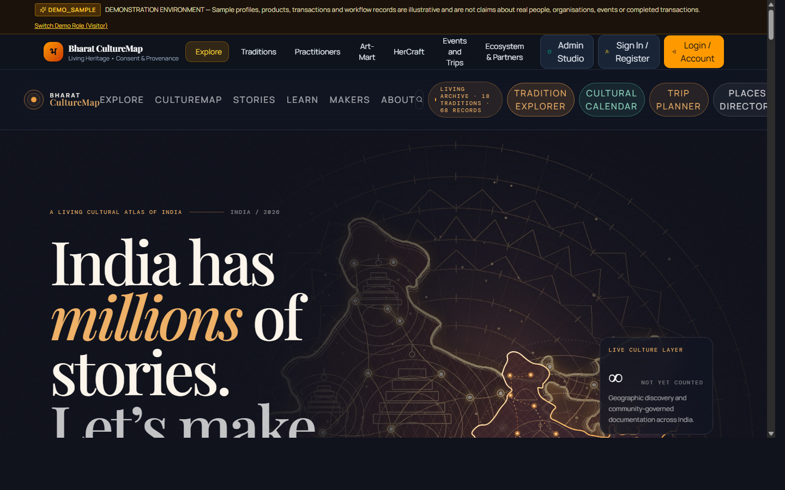

---

### Feature 2: Tradition Explorer & Living Heritage Registry (`/traditions`)
- **Primary Source Code**: [`client/src/pages/TraditionExplorer.tsx`](file:///D:/Bharat%20Culture%20Map%201/client/src/pages/TraditionExplorer.tsx), [`server/db/migrations/0005_traditions_sources_media.sql`](file:///D:/Bharat%20Culture%20Map%201/server/db/migrations/0005_traditions_sources_media.sql)
- **Technical Capabilities**:
  - Comprehensive catalog classified by **UNESCO Intangible Cultural Heritage (ICH)** domains and **Geographical Indication (GI)** registry status.
  - Dual-script support displaying native Devanagari nomenclature alongside English translations.
  - Relational mapping to primary source citations (`source_citations` table) linking to UNESCO dossiers, Sangeet Natak Akademi, and GI registries.
  - Media asset gallery (`media_assets` table) displaying high-resolution field photography, verified audio samples, and technique documentation.

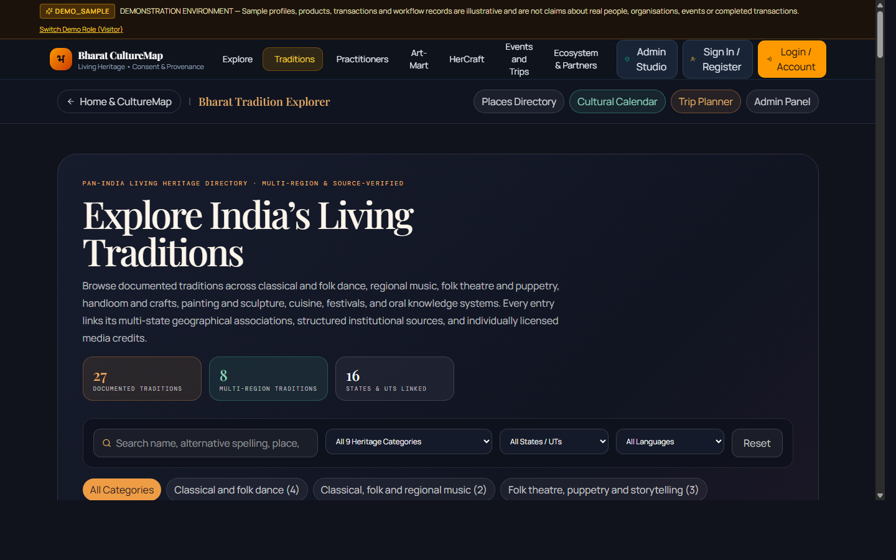

---

### Feature 3: HerCraft — Women Artisans & Enterprises (`/hercraft`)
- **Primary Source Code**: [`client/src/pages/HerCraft.tsx`](file:///D:/Bharat%20Culture%20Map%201/client/src/pages/HerCraft.tsx), [`server/db/hercraft-seed.ts`](file:///D:/Bharat%20Culture%20Map%201/server/db/hercraft-seed.ts)
- **Technical Capabilities**:
  - Dedicated initiative for women-led Self-Help Groups (SHGs), artisan collectives, and female enterprise leaders.
  - Enterprise profile cards with artisan counts, founded years, signature craft techniques, and support requirements (e.g., working capital, raw material access, digital marketing).
  - Aggregator for verified government funding schemes, CSR grants, and capacity-building workshops.
  - Integrated inquiry workflow enabling institutional buyers and NGOs to connect with women collectives under moderated privacy protocols.

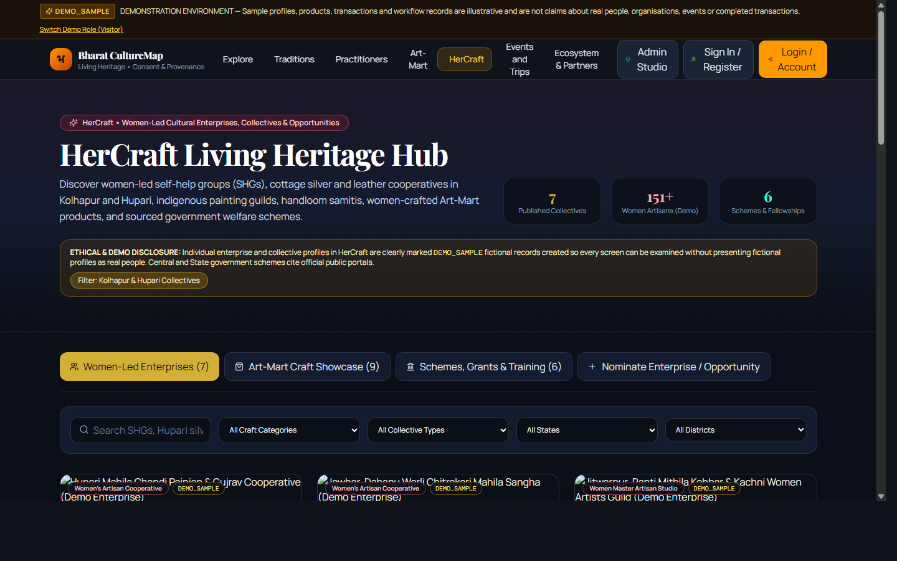

---

### Feature 4: Art-Mart — Fair-Trade Artisan Marketplace (`/art-mart`)
- **Primary Source Code**: [`client/src/pages/ArtMart.tsx`](file:///D:/Bharat%20Culture%20Map%201/client/src/pages/ArtMart.tsx), [`server/db/migrations/0006_demo_ecosystem_marketplace.sql`](file:///D:/Bharat%20Culture%20Map%201/server/db/migrations/0006_demo_ecosystem_marketplace.sql)
- **Technical Capabilities**:
  - Ethical e-commerce engine connecting consumers directly with verified traditional makers, eliminating exploitative middlemen.
  - Transparent product cards exhibiting pricing in INR (`₹`), live stock counters, material lists, and handcrafting timelines.
  - Full client-side shopping bag state management with checkout simulation, order number generation (`ORD-XXXXXXXX`), and automated delivery tracking simulation.
  - Direct provenance badge linking each product back to its verified cultural record and registered artisan profile.

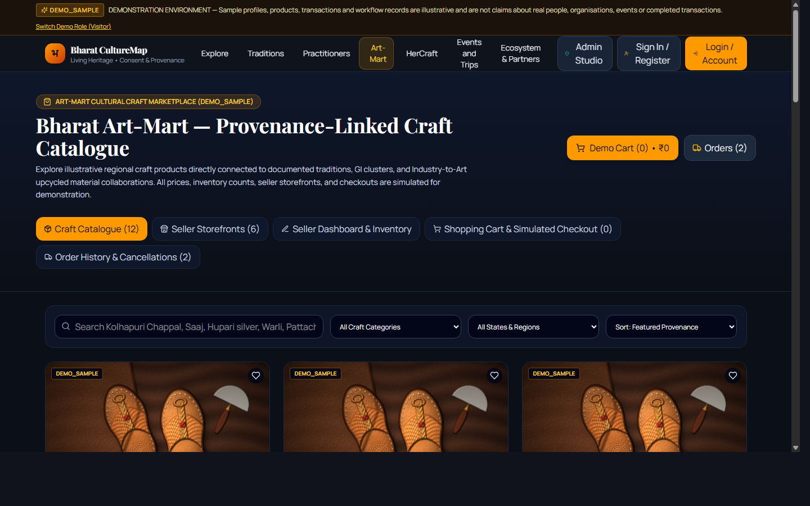

---

### Feature 5: Cultural Calendar & Intelligent Trip Planner (`/calendar`)
- **Primary Source Code**: [`client/src/pages/CulturalCalendar.tsx`](file:///D:/Bharat%20Culture%20Map%201/client/src/pages/CulturalCalendar.tsx), [`server/db/migrations/0003_cultural_calendar.sql`](file:///D:/Bharat%20Culture%20Map%201/server/db/migrations/0003_cultural_calendar.sql), [`server/db/migrations/0004_trip_planner.sql`](file:///D:/Bharat%20Culture%20Map%201/server/db/migrations/0004_trip_planner.sql)
- **Technical Capabilities**:
  - Dynamic cultural events calendar tracking solar, lunar, and seasonal festivals across India with regional holiday metadata.
  - Etiquette guides and visitor access rules (e.g., dress codes, photography permissions, entry requirements).
  - Algorithmic **Cultural Itinerary Generator**: Users specify travel dates, starting locations, and cultural interests; the backend computes an optimized day-by-day itinerary complete with distance estimations and master artisan workshop recommendations.

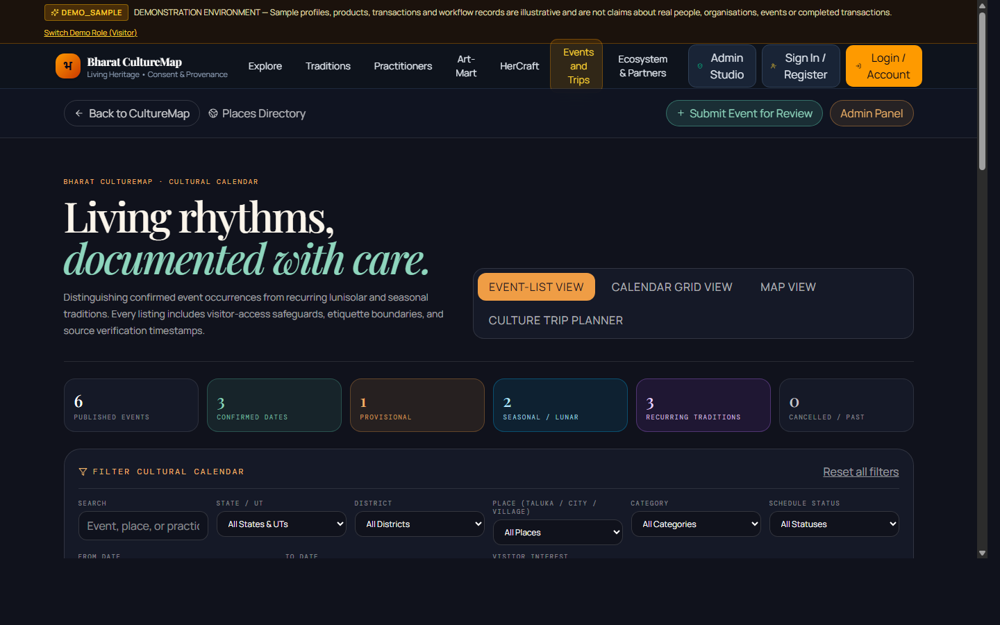

---

### Feature 6: Ecosystem Hub — Industry-to-Art & Resources (`/industry-to-art`)
- **Primary Source Code**: [`client/src/pages/EcosystemHub.tsx`](file:///D:/Bharat%20Culture%20Map%201/client/src/pages/EcosystemHub.tsx), [`server/db/demo-ecosystem-seed.ts`](file:///D:/Bharat%20Culture%20Map%201/server/db/demo-ecosystem-seed.ts)
- **Technical Capabilities**:
  - Circular economy raw material matching: Industrial manufacturers list clean surplus materials (e.g., organic textile scraps, brass turnings, natural leather offcuts) for donation or subsidized sale to traditional craft clusters.
  - Collaboration request tracker: Artisans request specific raw materials for upcycling projects and track admin/industry allocations.
  - Comprehensive directory of statutory boards (Development Commissioner of Handicrafts, Khadi and Village Industries Commission, Sangeet Natak Akademi) and verified government schemes.

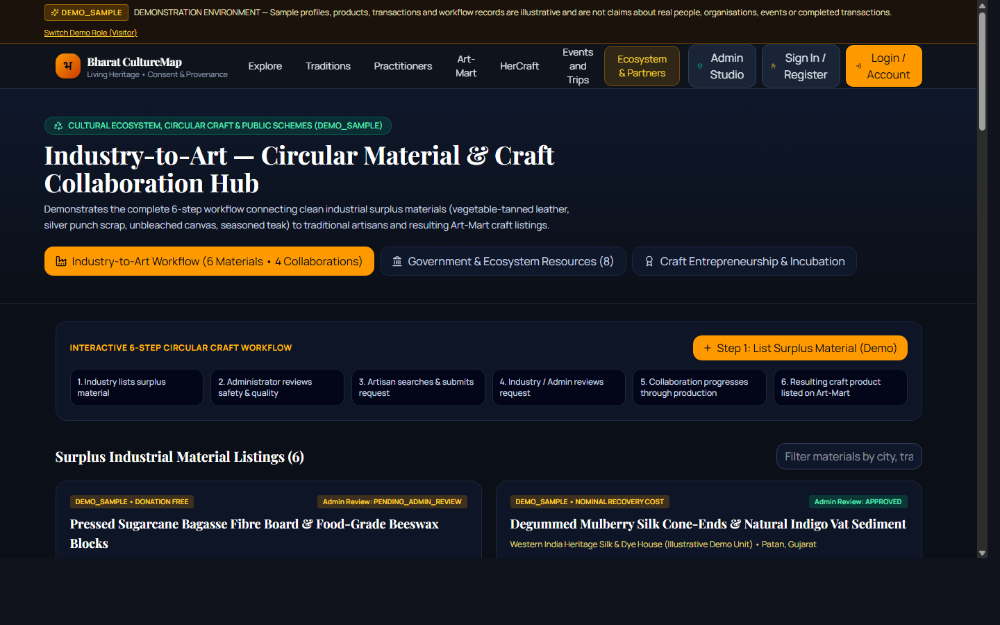

---

### Feature 7: Master Practitioners Directory (`/practitioners`)
- **Primary Source Code**: [`client/src/pages/Practitioners.tsx`](file:///D:/Bharat%20Culture%20Map%201/client/src/pages/Practitioners.tsx), [`server/db/repository.ts`](file:///D:/Bharat%20Culture%20Map%201/server/db/repository.ts)
- **Technical Capabilities**:
  - Living practitioner profiles documenting master artisans, performing artists, and oral historians.
  - Lineage notes, years of practice, workshop availability, and apprenticeship opportunities.
  - Privacy-preserving contact protocol: Facilitates direct workshop inquiries without exposing practitioner phone numbers or private residential addresses to web scrapers.

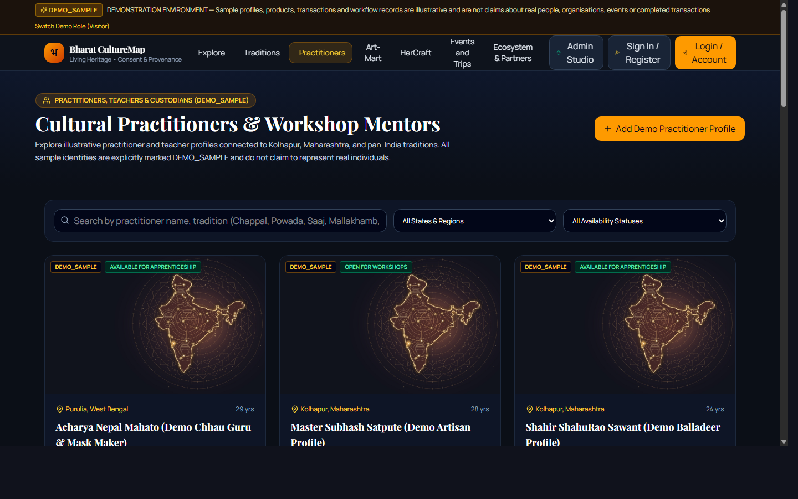

---

### Feature 8: Multi-Persona Authentication & Demo Switcher (`/login`)
- **Primary Source Code**: [`client/src/pages/AuthAccount.tsx`](file:///D:/Bharat%20Culture%20Map%201/client/src/pages/AuthAccount.tsx), [`server/modules/auth/index.ts`](file:///D:/Bharat%20Culture%20Map%201/server/modules/auth/index.ts)
- **Technical Capabilities**:
  - Unified authentication handling both standard user registration and role-based staff login.
  - Multi-persona registration supporting 5 public roles: `VISITOR`, `BUYER`, `PRACTITIONER`, `ARTISAN_SELLER`, `HERCRAFT_ENTREPRENEUR`.
  - Development Demo Role Switcher: One-click session impersonation across all 5 governance roles for rapid stakeholder demonstration (automatically disabled when `ENABLE_DEMO_ACCOUNTS=false` in production).

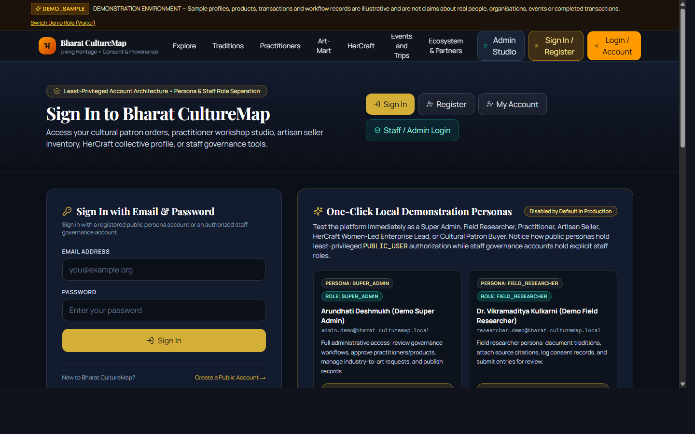

---

### Feature 9: Admin & Governance Management Console (`/admin`)
- **Primary Source Code**: [`client/src/pages/AdminPanel.tsx`](file:///D:/Bharat%20Culture%20Map%201/client/src/pages/AdminPanel.tsx), [`server/modules/consent-gate/index.ts`](file:///D:/Bharat%20Culture%20Map%201/server/modules/consent-gate/index.ts)
- **Technical Capabilities**:
  - Multi-tab governance console covering Records Management, User Administration, Geographic Hierarchy, Event Approvals, Inquiries, Traditions Curation, and Audit Provenance Logs.
  - Live inspection of the **Cultural Rights Passport Publication Gate**: Visually displays why a record is approved or blocked for publication with exact criteria breakdown.
  - Built-in multi-part image uploader with real-time thumbnail preview and local server persistence.

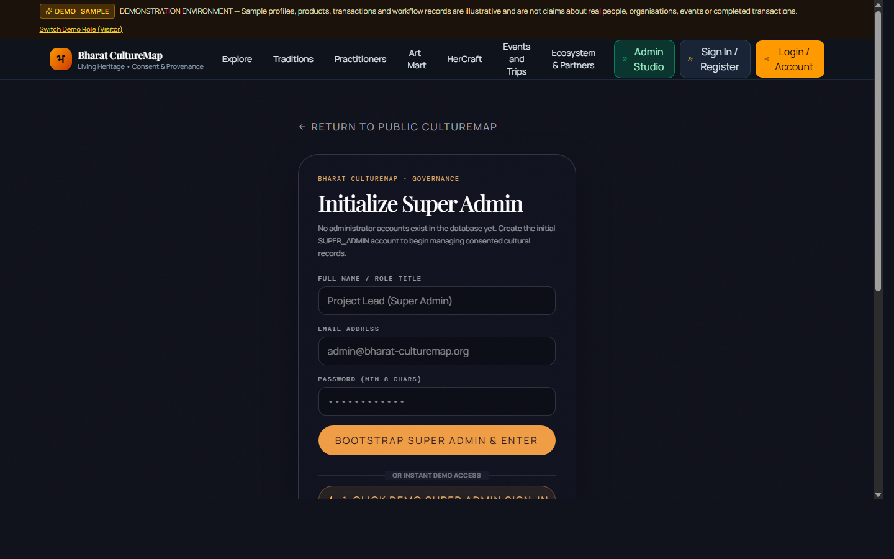

---

## 3. The Cultural Rights Passport & Publication Gate Engine

The central intellectual property innovation in Bharat CultureMap is the **Cultural Rights Passport**, derived from Instrument 6.1 of the HLFA Research Master File. It ensures that indigenous cultural practices cannot be commodified, misrepresented, or fed into AI models without explicit, informed consent.

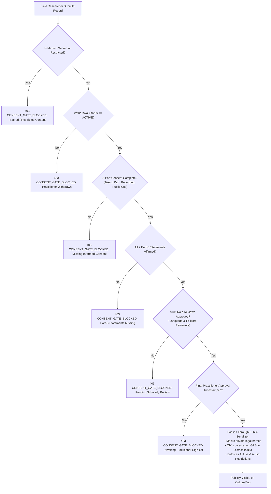

### The 9 Rights Passport Conservative Defaults

| Passport Field | Conservative Default | Supported Options | Enforced Backend Behavior |
| :--- | :--- | :--- | :--- |
| **1. Identity Display** | `CHOSEN_NAME` | `FULL_NAME`, `CHOSEN_NAME`, `COMMUNITY_NAME`, `ANONYMOUS` | Masks legal name (`practitioner_full_name_private`) in all public API responses. |
| **2. Location Granularity** | `DISTRICT` | `EXACT_WORKSHOP`, `VILLAGE`, `CITY_TOWN`, `TALUKA`, `DISTRICT`, `HIDDEN` | Rounds exact GPS coordinates (`exact_lat_private`, `exact_lng_private`) to the center of the chosen administrative unit. |
| **3. Audio/Video Access** | `PRIVATE` | `PUBLIC`, `LIMITED`, `PRIVATE`, `NOT_PERMITTED` | Omits raw oral history audio URLs unless explicitly granted `PUBLIC` permission. |
| **4. Translation Scope** | `ORIGINAL_ONLY` | `ORIGINAL_ONLY`, `SELECTED_LANGUAGES`, `NONE` | Restricts automated translation, preserving vernacular nuance in original Devanagari/Marathi. |
| **5. AI Ingestion / Training** | `NONE` | `NONE`, `TRANSCRIPT_DRAFT_ONLY`, `TRANSLATION_DRAFT_ONLY`, `APPROVED_RETRIEVAL` | Explicitly bans third-party LLM scraping, fine-tuning, and voice cloning. |
| **6. Download & Reuse** | `PERMISSION_REQUIRED` | `ALLOWED`, `EDUCATIONAL_ONLY`, `PERMISSION_REQUIRED`, `PROHIBITED` | Prevents automated media downloads and enforces watermarking. |
| **7. Commercial Use** | `PROHIBITED` | `PROHIBITED`, `PERMISSION_REQUIRED`, `BENEFIT_SHARING_AGREEMENT` | Strictly forbids unauthorized corporate exploitation or commercial merchandising. |
| **8. Contact Mode** | `MODERATED_ENQUIRY` | `DIRECT`, `MODERATED_ENQUIRY`, `UNAVAILABLE` | Routes all inquiries through the admin platform without exposing phone numbers or emails. |
| **9. Withdrawal Status** | `ACTIVE` | `ACTIVE`, `CORRECT_REQUESTED`, `RESTRICTED`, `REMOVED` | If changed from `ACTIVE`, the record immediately unpublishes across all public endpoints in sub-millisecond real time. |

---

## 4. Database Schema & Entity Relationship Model

The system utilizes 19 normalized relational tables defined in [`server/db/migrations/`](file:///D:/Bharat%20Culture%20Map%201/server/db/migrations/):

```mermaid
erDiagram
    users ||--o{ cultural_records : creates
    users ||--o{ provenance_logs : performs
    users ||--o{ art_mart_sellers : owns
    users ||--o{ hercraft_enterprises : manages
    locations ||--o{ locations : "parent_id (hierarchy)"
    locations ||--o{ cultural_records : locates
    locations ||--o{ tradition_places : associates
    locations ||--o{ cultural_events : hosts

    cultural_records ||--|| rights_passports : governs
    cultural_records ||--o{ heritage_vocabulary : defines
    cultural_records ||--o{ provenance_logs : audits
    cultural_records ||--o{ source_citations : references
    cultural_records ||--o{ media_assets : displays

    traditions ||--o{ tradition_places : locates
    traditions ||--o{ cultural_records : categorizes
    traditions ||--o{ source_citations : cites
    traditions ||--o{ media_assets : showcases
    traditions ||--o{ art_mart_products : inspires
    traditions ||--o{ hercraft_enterprises : links

    practitioner_profiles ||--o{ art_mart_sellers : links
    practitioner_profiles ||--o{ hercraft_enterprises : advises
    art_mart_sellers ||--o{ art_mart_products : lists
    art_mart_orders ||--o{ art_mart_products : includes

    industry_materials ||--o{ industry_requests : requests
    industry_requests ||--o{ art_mart_products : outputs
```

### Key Database Tables

1. **`users`**: User identities, PBKDF2 password hashes, and assigned roles (`SUPER_ADMIN`, `FIELD_RESEARCHER`, `LANGUAGE_REVIEWER`, `FOLKLORE_REVIEWER`, `PRACTITIONER_APPROVER`, `PUBLIC_USER`).
2. **`locations`**: Administrative hierarchy levels (`COUNTRY`, `STATE`, `DISTRICT`, `TALUKA`, `CITY_TOWN`, `VILLAGE`) with latitude, longitude, and default zoom levels.
3. **`cultural_records`**: Core living heritage entries containing dual-language content (English & Marathi), categories, and private practitioner fields.
4. **`rights_passports`**: 9 passport fields and 7 Part-B consent statements with version history.
5. **`provenance_logs`**: Immutable audit trail documenting who collected, transcribed, translated, narrated, reviewed, and approved every record.
6. **`traditions` & `tradition_places`**: High-level living heritage registry entries mapped across multiple states and districts.
7. **`art_mart_products`, `art_mart_sellers`, `art_mart_orders`**: Complete fair-trade marketplace infrastructure.
8. **`hercraft_enterprises` & `hercraft_opportunities`**: Dedicated women artisan enterprise catalog and scheme directory.
9. **`industry_materials` & `industry_requests`**: Circular economy industrial surplus-to-craft pipeline.
10. **`cultural_events` & `trip_plans`**: Festival scheduling and personalized cultural travel itineraries.

---

## 5. Security Architecture & Deployment Topology

### Security & Privacy Protections
- **Zero-Trust Field Isolation**: Private fields (`practitioner_phone_private`, `practitioner_address_private`, `exact_lat_private`, `witness_name_private`) are filtered at the repository layer and are never sent over public API routes.
- **Cryptographic Session Tokens**: Uses signed HMAC-SHA256 session tokens stored in `HttpOnly`, `SameSite=Lax` cookies, protected with a minimum 32-character `SESSION_SECRET`.
- **Brute-Force Rate Limiting**: In-memory sliding window rate limiter protects `/api/v1/auth/login` and `/api/v1/auth/register`.
- **Strict Role-Based Access Control (RBAC)**: All administrative endpoints under `/api/v1/admin/*` verify user roles before granting write access.

### Production Deployment Blueprint
Because Bharat CultureMap relies on a native SQLite relational database (`better-sqlite3` in WAL mode) and active Node.js server processes, it cannot be hosted on static hosts like GitHub Pages. Recommended production environments include:

1. **Fly.io / Render / Railway**: Mount a persistent volume at `/var/data` and configure `SQLITE_DB_PATH=/var/data/bharat_culturemap.sqlite`.
2. **Litestream Replication**: Enable continuous streaming replication of SQLite transactions to Cloudflare R2 or AWS S3 for zero-loss disaster recovery.
3. **Local Wi-Fi Testing**: The Vite dev server is preconfigured with `--host 0.0.0.0:3000` to allow instantaneous phone testing across local Wi-Fi networks.
